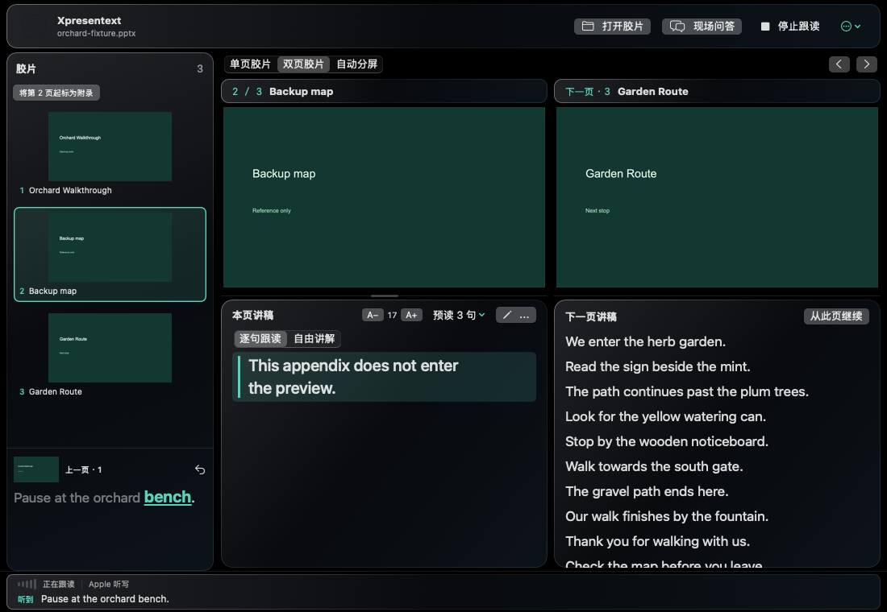
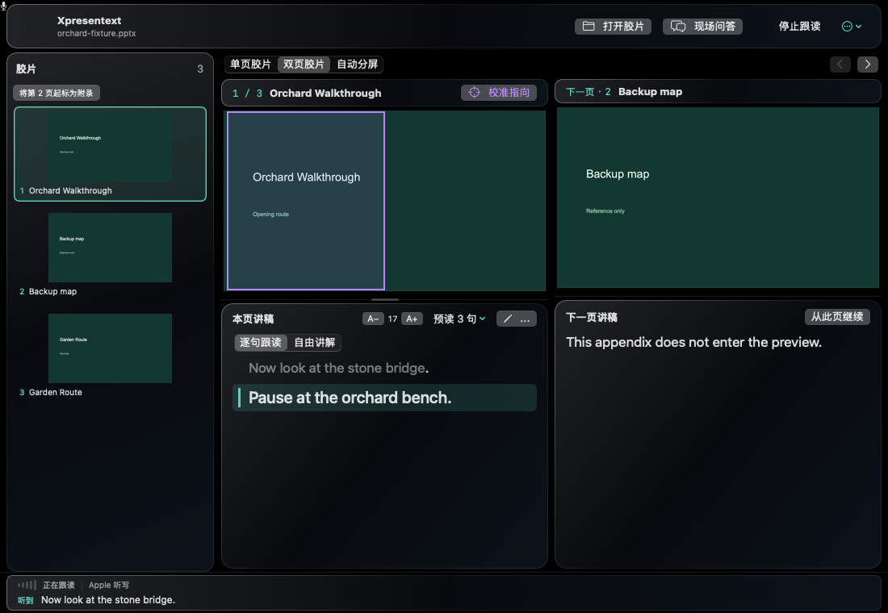

<p align="center"></p>

# Xpresentext

Xpresentext 是个人 Mac 上的演讲工作区。放映电脑照常播放 PowerPoint，演讲者在自己的 Mac 打开同一份 PPTX，看备注、按发言进度逐词跟读，并在被提问时调出带胶片页码的答案。两台电脑可以独立运行。



**跟读时自动翻页，自由讲解时手动翻页。** 逐句朗读时，讲到页末就能提前看下一页；自由发挥时，工作区留在本页，标出还没讲到的要点。遇到提问，可以打开问答浮窗，根据页码找回回答依据。

| 进入末句前 | 进入下一页后 |
| --- | --- |
|  |  |

**macOS 15+ · 源码发布 · GPLv3**　[从源码构建](#构建-macos-应用) · [许可全文](LICENSE) · [第三方声明](THIRD_PARTY_NOTICES.md)

## 第一次试讲

1. 打开 **Xpresentext.app**，把 PPTX 拖进窗口。选中一页，检查或编辑英文讲稿。个人改稿保存在本机。已有 Textream Studio 备稿可直接继续使用。
2. 点 **开始跟读**，允许麦克风和语音识别。读完一句，同页的下一句会高亮，已读稿以浅灰色保留最近一句。漏掉句尾时可以继续朗读；若已经读到更后面，跟读器可根据连续两句重新定位。选 **双页胶片**，右侧立即显示下一张胶片和讲稿，点右栏任一句即可从那页那句继续。选 **自动分屏**，则在进入本页最后三句时展开右栏。逐句跟读识别到本页末句时，下一正文页提前进入主区，右侧预览再下一页。左下角保留原页缩略图和正在读的末句；点缩略图可回去继续讲。用 **单页胶片** 可切回单栏，点击句子或翻页箭头可手动定位。讲稿栏的 **A− / A+** 可同步调整左右栏字号（12–32 点），下次打开会保留。预读菜单可以单独放大当前词。读到中括号指向提示时，胶片会框出相应区域。标题和成组标签按 PPT 文本框与讲稿定位，单独的左右方向提示标出对应半页。遇到目标不明确的提示，可点 **框选指向**，保存的框下次继续使用。
3. 在 **更多 → 模型与显示设置** 选择回答服务。DeepSeek 使用自己的 API 密钥，Grok CLI 使用本机已有登录。点击 **现场问答**，输入问题或复述听到的问题。点击回答的页码可预览出处，点 **从本页讲稿继续** 再移动跟读位置。
4. 英文跟读默认用 Apple 语音识别。在 Apple Silicon Mac 上也可选 Whisper Turbo，首次启用需下载约 1.6 GB 模型。选择会议声音时需要 macOS 系统音频录制权限。中文问题夹英文术语时，可用 **修改转写** 改词后重问。


首页与胶片工作区共用固定的月面广角视角。打开时地球上亮下暗，晨昏线略微倾斜。地球以每秒 30 帧的目标帧率自转，每 96 秒一圈，约一分钟后，月影从近乎全亮的地球上扫过，本影外围有柔和的半影。场景采用便于观察的时间与距离比例。macOS 的“减弱动态效果”可将其定格。


窗口底部显示麦克风状态和当前听写引擎。选择 Whisper Turbo 时，可以区分 **未下载**、**已下载 · 未加载**、**加载中** 和 **已加载**。跟读启动后会显示输入音量及最近听到的英文。停止跟读会释放 Whisper 的运行内存，已下载的文件保留在 Mac。点底部引擎名称进入设置。

## 英文自由讲解

打开英文讲稿，开启 **自由讲解**，点 **开始跟读**。可以先讲第三个要点，再回头补第一个。说话时先显示临时位置，听写定稿后才将已讲内容变灰并打勾。漏讲的内容保持亮色。明确写入讲稿的问句也可以逐句跟读。讲稿栏显示本页还有几项待讲。中括号动作保留紫色，点击任何一句仅移动提词位置。使用双页时，右侧预览也保留自己的已讲记录。即使讲完全部要点或提到下一页，主画面也留在本页。准备好后，点翻页箭头、侧栏页码或右侧讲稿继续。问答期间记录暂停。下一场可在 FineCat 菜单选择 **清空本场已讲记录**。

Apple Silicon Mac 第一次使用改述识别时，选择 **FineCat → 下载或修复 FineCat（1.5 GB）**。菜单显示 **FineCat · 已加载** 后，Apple 或 Whisper 定稿的英文均由本机 FineCat 判断，可以断网。也可选择已有的官方模型目录。模型准备前可用原句匹配。建议每个独立要点写成一句或单独一行；一条长句包含多个结论时，本版按整句确认。[模型来源与许可](Textream/Murmury/english_coverage/NOTICE.md) · [英文样本、要点召回及误灰记录](Tests/CompanionTracking/EnglishCoverage/README.md)

## 构建 macOS 应用

需要 macOS 15 或更高版本及 Xcode Command Line Tools。完整问答浮窗与可选 Whisper 跟读使用 Apple Silicon、uv 和 Python 3.12。首次构建需要下载锁定的依赖。PPT 渲染可使用本机 LibreOffice，也可从 PowerPoint 导出同版 PDF 以更新画面。

```sh
./Textream/build-local.sh
open "Textream/build/local/current/Xpresentext.app"
```

此脚本生成本机签名的应用。使用已有备稿时请先退出旧版。密钥使用现有 macOS 钥匙串条目。在线提问会将问题与选中的备稿依据发送给配置的服务。可选在线听写和读图由用户开启。

## 开源来源与再分发

Xpresentext 整合并二次开发了两款开源产品。

| 上游项目 | 在 Xpresentext 中的用途与改动 | 许可与声明 |
|---|---|---|
| [Textream](https://github.com/f/textream) · Fatih Kadir Akın | 复用原生 Mac 提词器和经典提词模式，扩展了 PPTX 备稿、跨页逐词跟读、指向框、换版和月景工作区。 | MIT。复制或分发其代码或实质部分时须保留版权与许可声明。[MIT 全文](LICENSES/Textream-MIT.txt) |
| [Murmury](https://github.com/GianlucaBave/murmury) · GianlucaBave 与贡献者 | 复用浮窗、会议音频采集和 Whisper 转写，以本地进程连接当前 PPT、追问和引用页预览。 | GPL-3.0。修改过的 Murmury 与本项目的 Python 适配层按相同许可提供。分发相应二进制时，须向接收者按 GPL 第 6 节提供对应源码，包括修改及构建所需脚本，并保留许可、版权与修改说明。[许可全文](Textream/Murmury/upstream/LICENSE) · [来源、修改与重建](Textream/Murmury/NOTICE.md) |

Xpresentext 按 GPLv3 发布，允许使用、修改、商用和再分发。保留上游 Textream 的 MIT 版权与许可声明。分发整包时，应将该版本的完整对应源码与构建材料一并提供给接收者。Python、Qt 等依赖各自的许可继续适用。[依赖锁文件](Textream/Murmury/uv.lock)

地球纹理采用 NASA Blue Marble。月面全景与应用图标为本项目生成的视觉素材。OpenDyslexic 字体按 SIL Open Font License 提供。[场景素材署名](Textream/Textream/LunarAssets/Credits.txt) · [字体许可](Textream/Textream/Fonts/OpenDyslexic-OFL.txt)

## 本机验证

`Tests/verify-companion.sh` 检查月景与投影、跟读、听题、备稿、引用、断网行为及应用内的 Murmury 助手。测试 Python 需要可导入 python-pptx、Pillow 和 lxml，可通过 DECK_PYTHON 指定解释器。涉及设备权限、会议声音或在线服务的现场试讲需要使用真实设备和账号。
